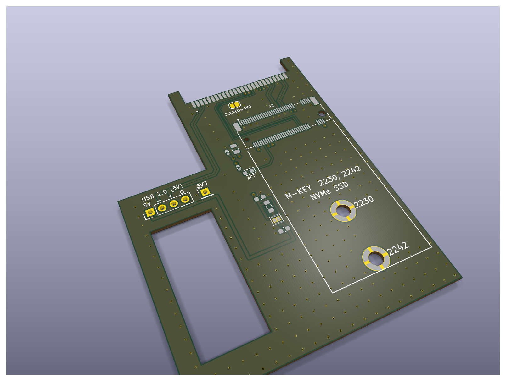
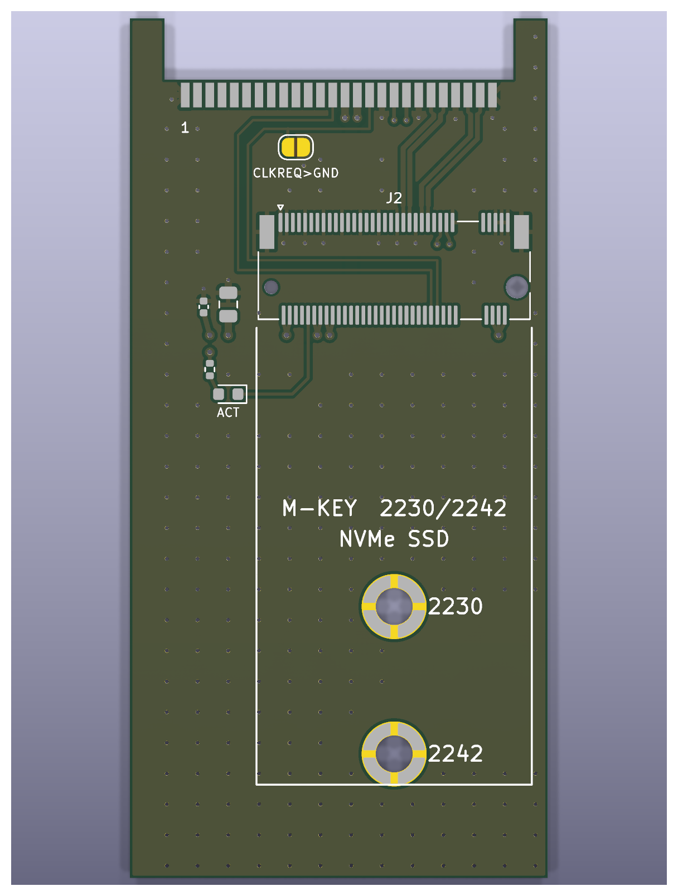
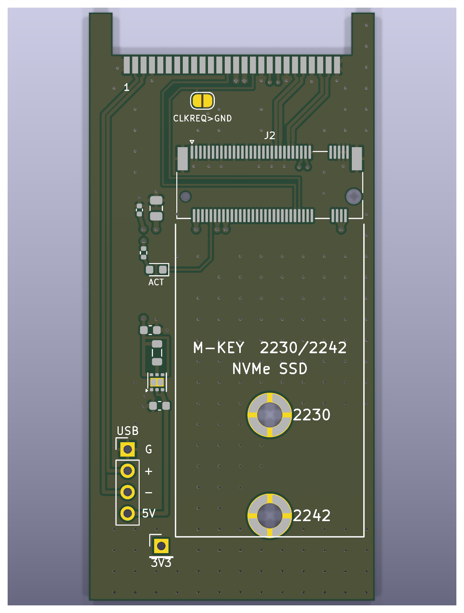
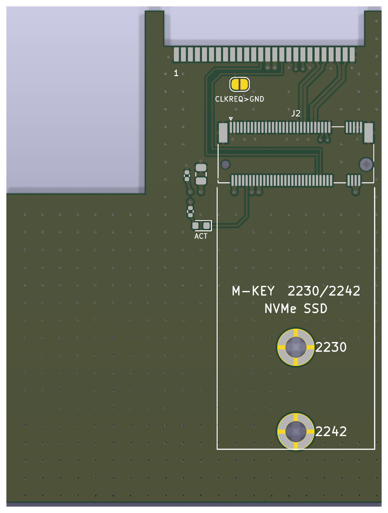
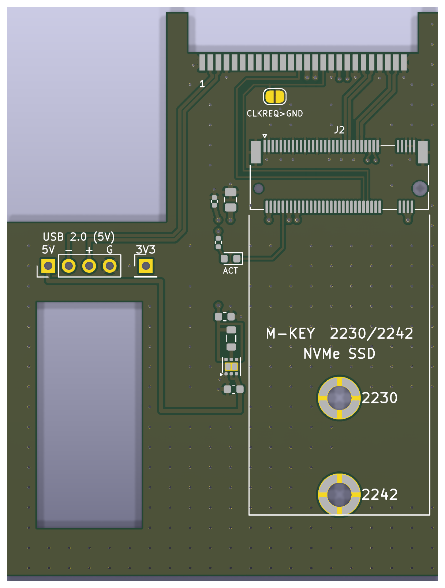
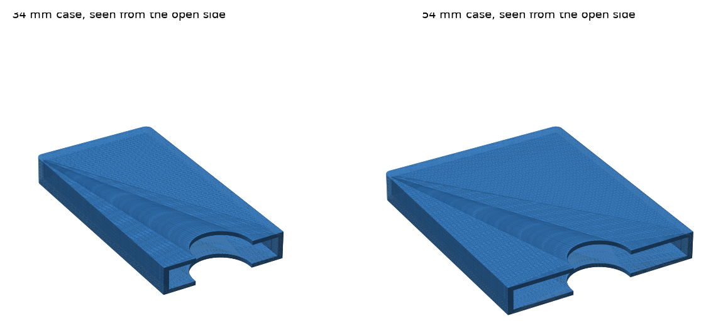

# ExpressCard → M.2 NVMe for the ThinkPad X230

An adapter that lets you use an **M.2 NVMe 2230 or 2242** SSD (M-key or B+M-key) in the **ExpressCard/54** slot
of a ThinkPad X230 (and in general in any ExpressCard slot with PCIe). It is a bare board, with no shell, that slides
straight into the slot. It is 70 mm long, like "short" ExpressCards: it sits flush with the slot instead of sticking out.



> **Status:** design complete and DRC-clean, **not yet manufactured or tested on hardware**.
> Before ordering, follow the *Checks before ordering* section of the [guide](GUIDE.md).

## Variants

| Variant | Form factor | USB | Notes |
|---|---|---|---|
| `EC2M2_34` | ExpressCard/34 (34 × 70 mm) | no | fits /34 and /54 slots |
| `EC2M2_34_USB5V` | ExpressCard/34 | yes, 5 V | USB pads on the left side, next to the M.2 |
| `EC2M2_54` | ExpressCard/54 (L-shaped, 54 × 70 mm) | no | more stable in a /54 slot |
| `EC2M2_54_USB5V` | ExpressCard/54 | yes, 5 V | USB pads + cut-out to house a small USB receiver |

| 34 mm | 34 mm + USB | 54 mm | 54 mm + USB |
|---|---|---|---|
|  |  |  |  |

The ExpressCard and M.2 connectors have no 3D model in the library: only their pads show up in the renders.

## Features

- **PCIe x1** from the ExpressCard slot to the M.2 connector (M-key, 3.2 mm height); differential pairs at **~87 Ω**
  (computed with an included 2D field solver, `gen/impedance.py`).
- **Screw mounting** for the SSD: two M2 SMT nuts (H 1.0 mm) at the 2230 and 2242 positions.
- SSD **activity LED** and an optional **CLKREQ#→GND jumper** for SSDs that are not detected.
- **USB versions:** the slot's USB 2.0 port is brought out to pads, with a **3.3 → 5 V boost** (TPS61240, 200 mA guaranteed)
  because the ExpressCard slot does not provide 5 V. The power block sits in the free strip to the left of the SSD. A **separate 3.3 V pad** (3V3) is for 3.3 V devices
  or measurements; it is placed away from the 5V pad so the two cannot be confused.
- 2 layers, 1.0 mm thick, JLCPCB-compatible rules; BOM with LCSC part numbers and assembly-ready files.
- On the back: a small **QR code** linking to this repository.
- **3D-printable case** for transport and storage (see below).

## Printable case



In the slot the board must be used **bare**: the ExpressCard slot is 5.0 mm tall and board + SSD already reach about 4.85 mm,
so there is no room for a shell. The case is for carrying and storing it with the SSD installed: the board slides in
from the open side, two small bumps hold it in place and the notches let you grab it.

- Ready-made STLs: `out/enclosure/EC2M2_34_case.stl` (38 × 72 × 8.4 mm) and `EC2M2_54_case.stl` (58 × 72 × 8.4 mm).
- Editable source: `out/enclosure/enclosure.scad` (OpenSCAD), or the parameters in `gen/enclosure.py`.
- Print it **standing on its open side**: no supports or long bridges. PLA or PETG, 0.2 mm layers, 3 perimeters.

## Repository contents

```
gen/                 generator and tools
  gen_board.py       builds the PCB of one variant (KiCad 10 Python API)
  build.sh           generates the 4 variants + DRC
  fab.sh             Gerbers, drill, CPL, renders, 1:1 PDF, JLCPCB files
  render.sh          3D renders into docs/img
  check_nets.py      checks the netlist against the expected mapping
  impedance.py       differential pair impedance calculation (requires scipy)
  jlc_search.py      LCSC/JLC part number search
  jlc_files.py       JLC-format BOM/CPL + component cost estimate
  enclosure.py       3D-printable case (STL + OpenSCAD)
out/<variant>/       KiCad project (.kicad_pcb/.kicad_pro/.kicad_dru), BOM, footprint library
  fab/               Gerbers, drill, CPL, 1:1 PDF, quick renders
  jlcpcb/            Gerber zip, BOM and CPL for JLCPCB, cost estimate
out/enclosure/       case STLs and OpenSCAD source
docs/img/            renders
GUIDE.md             checks, ordering, assembly, first boot
HANDOFF.md           design notes: pinout, choices, calculations
```

## Regenerating the files

You need KiCad 10 with the footprint libraries (`kicad-library`) and Python 3.

```sh
gen/build.sh        # generates the 4 variants and runs the DRC
gen/fab.sh          # production and JLCPCB files
gen/render.sh       # renders (also needs kicad-library-3d)
```

For impedance and the case: `python3 -m venv gen/.venv && gen/.venv/bin/pip install scipy manifold3d trimesh matplotlib`.
Case: `gen/.venv/bin/python gen/enclosure.py`. Impedance:
`gen/.venv/bin/python gen/impedance.py 0.4,0.15,0.25` (width, spacing between traces, distance to GND, in mm).

## Indicative cost

Only the components assembled by JLCPCB (API prices, October 2026): about **$10** for 5 boards without USB, **$17** with USB,
plus the PCB, assembly setup and shipping. Details in `out/<variant>/jlcpcb/<variant>_estimate.md`.
The ExpressCard connector is not available from LCSC: it must be bought separately and soldered by hand.

## License

This project (hardware design, documentation and scripts) is released under the
[Creative Commons Attribution-NonCommercial-ShareAlike 4.0 International](https://creativecommons.org/licenses/by-nc-sa/4.0/)
license (CC BY-NC-SA 4.0). You may build, modify and share it for **non-commercial** purposes, crediting the author and
releasing derivative works under the same license. Selling boards or derivatives requires permission from the author.
See [LICENSE](LICENSE).
