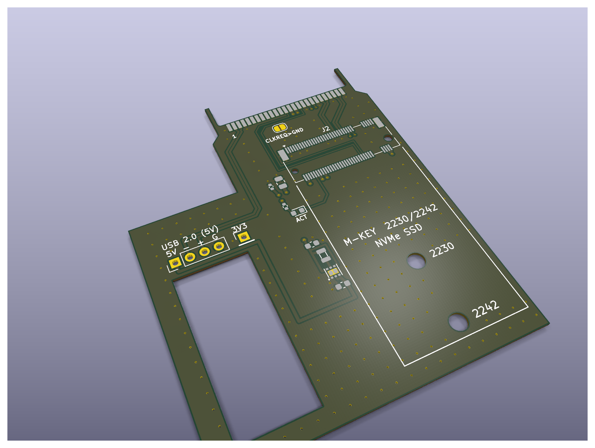
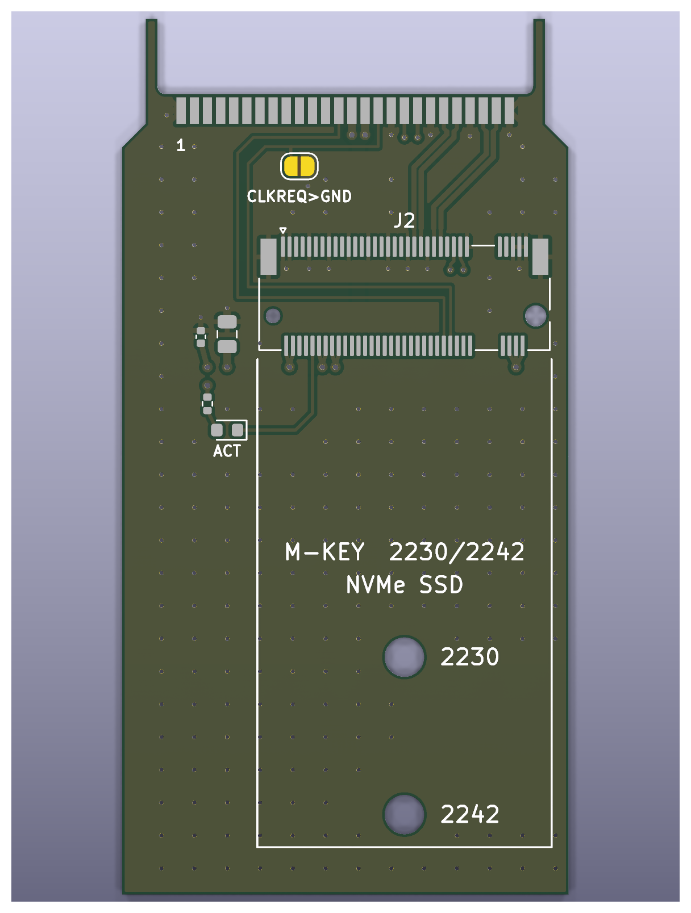
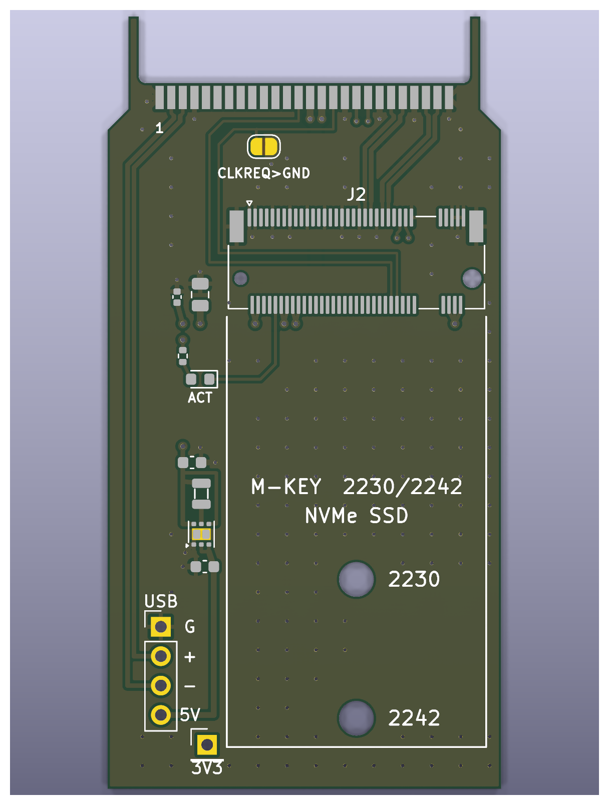
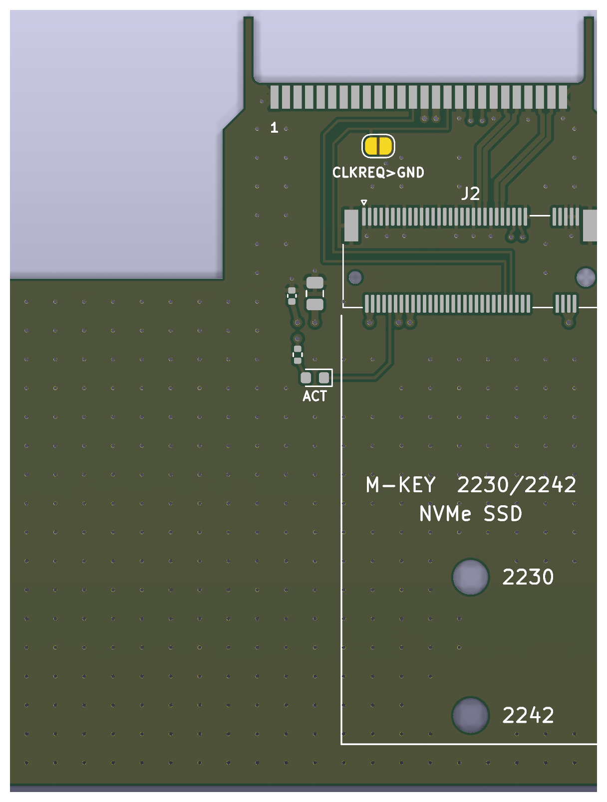
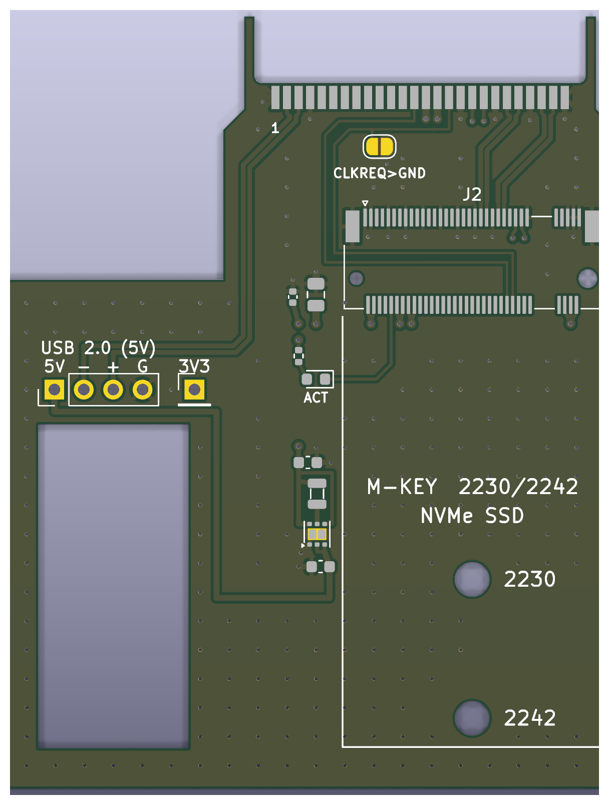
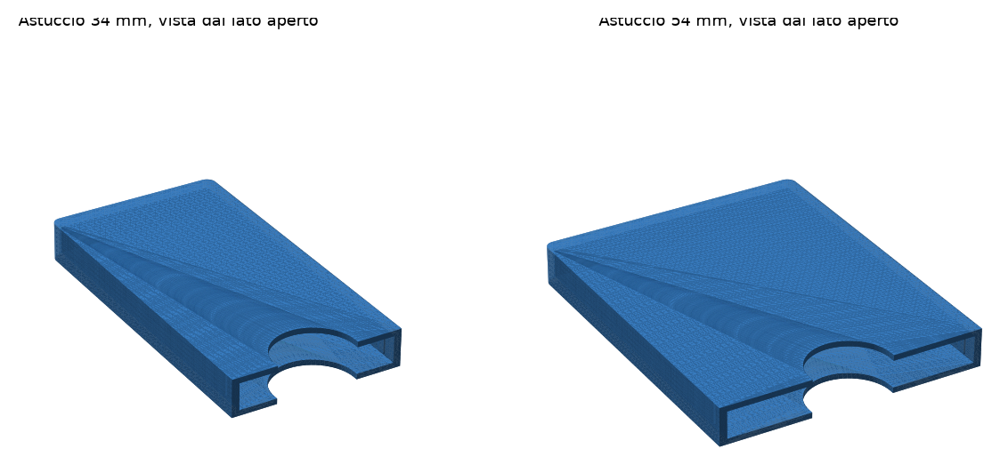

# ExpressCard → M.2 NVMe for the ThinkPad X230

An adapter that lets you use an **M.2 NVMe 2230 or 2242** SSD (M-key or B+M-key) in the **ExpressCard/54** slot
of a ThinkPad X230 (and in general in any ExpressCard slot with PCIe). It is a bare board, with no shell, that slides
straight into the slot. It is 70 mm long, like "short" ExpressCards: it sits flush with the slot instead of sticking out.



> **Status:** design complete and DRC-clean, **not yet manufactured or tested on hardware**.
> Before ordering, follow the *Checks before ordering* section of the [guide](GUIDE.md).

## Variants

| Variant | Form factor | USB | Notes |
|---|---|---|---|
| `EC2M2_34` | ExpressCard/34 (34 × 70 mm) | no | fits /34 and /54 slots |
| `EC2M2_34_USB5V` | ExpressCard/34 | yes, 5 V | USB pads on the left side, next to the M.2 |
| `EC2M2_54` | ExpressCard/54 (L-shaped, 54 × 70 mm) | no | more stable in a /54 slot |
| `EC2M2_54_USB5V` | ExpressCard/54 | yes, 5 V | USB pads + cut-out to house a small USB receiver |

| 34 mm | 34 mm + USB | 54 mm | 54 mm + USB |
|---|---|---|---|
|  |  |  |  |

The renders show the bare board only (outline, copper, silkscreen): the components have no 3D models here.

## Features

- **PCIe x1** from the ExpressCard slot to the M.2 connector (M-key, low-profile 2.3 mm: **single-sided SSDs only**); differential pairs at **~86 Ω**
  (computed with an included 2D field solver, `gen/impedance.py`).
- **Screw mounting** for the SSD (**single-sided only**): two M2 SMT nuts (H 1.0 mm) on the bottom side at the 2230 and 2242
  positions (hand-soldered, optional: without them the SSD is held with kapton tape).
- SSD **activity LED** and an optional **CLKREQ#→GND jumper** for SSDs that are not detected.
- **USB versions:** the slot's USB 2.0 port is brought out to pads, with a **3.3 → 5 V boost** (TPS61240, 200 mA guaranteed)
  because the ExpressCard slot does not provide 5 V. The power block sits in the free strip to the left of the SSD. A **separate 3.3 V pad** (3V3) is for 3.3 V devices
  or measurements; it is placed away from the 5V pad so the two cannot be confused.
- 2 layers, **0.6 mm** thick (required by the ExpressCard connector), JLCPCB-compatible rules; BOM with LCSC part numbers and assembly-ready files.
- ExpressCard connector footprint and board outline (arms into the connector rails) taken from the FCI **10030570** drawing (rev M).
- On the back: a small **QR code** linking to this repository.
- **3D-printable case** for transport and storage (see below).

## Printable case



In the slot the board must be used **bare**: the ExpressCard connector housing already takes the whole 5.0 mm module
thickness, and the board + SSD fit inside that height, so there is no room for a shell. The case is for carrying and storing it with the SSD installed: the board slides in
from the open side, two small bumps hold it in place and the notches let you grab it.

- Ready-made STLs: `out/enclosure/EC2M2_34_case.stl` (38 × 72 × 8.4 mm) and `EC2M2_54_case.stl` (58 × 72 × 8.4 mm).
- Editable source: `out/enclosure/enclosure.scad` (OpenSCAD), or the parameters in `gen/enclosure.py`.
- Print it **standing on its open side**: no supports or long bridges. PLA or PETG, 0.2 mm layers, 3 perimeters.

## Repository contents

```
gen/                 generator and tools
  gen_board.py       builds the PCB of one variant (KiCad 10 Python API)
  build.sh           generates the 4 variants + DRC
  fab.sh             Gerbers, drill, CPL, renders, 1:1 PDF, JLCPCB files
  render.sh          3D renders into docs/img
  check_nets.py      checks the netlist against the expected mapping
  impedance.py       differential pair impedance calculation (requires scipy)
  jlc_search.py      LCSC/JLC part number search
  jlc_files.py       JLC-format BOM/CPL + component cost estimate
  enclosure.py       3D-printable case (STL + OpenSCAD)
out/<variant>/       KiCad project (.kicad_pcb/.kicad_pro/.kicad_dru), BOM, footprint library
  fab/               Gerbers, drill, CPL, 1:1 PDF, quick renders
  jlcpcb/            Gerber zip, BOM and CPL for JLCPCB, cost estimate
out/enclosure/       case STLs and OpenSCAD source
docs/img/            renders
GUIDE.md             checks, ordering, assembly, first boot
HANDOFF.md           design notes: pinout, choices, calculations
```

## Regenerating the files

You need KiCad 10 with the footprint libraries (`kicad-library`, or `KICAD_FPLIB=<footprints dir>`) and Python 3.

```sh
gen/build.sh        # generates the 4 variants and runs the DRC
gen/fab.sh          # production and JLCPCB files
gen/render.sh       # renders (also needs kicad-library-3d)
```

For impedance and the case: `python3 -m venv gen/.venv && gen/.venv/bin/pip install scipy manifold3d trimesh matplotlib`.
Case: `gen/.venv/bin/python gen/enclosure.py`. Impedance:
`gen/.venv/bin/python gen/impedance.py 0.4,0.15,0.25,0.53` (width, spacing between traces, distance to GND,
dielectric height, in mm; 0.53 for the 0.6 mm board).

## Indicative cost

Only the components assembled by JLCPCB (API prices, November 2026): about **$5** for 5 boards without USB, **$11** with USB,
plus the PCB, assembly setup and shipping. Details in `out/<variant>/jlcpcb/<variant>_estimate.md`.
The ExpressCard connector is not available from LCSC: it must be bought separately and soldered by hand, like the
two M2 nuts on the bottom side.

## Known issues and sourcing notes

- **J1 (ExpressCard connector) sourcing.** Not on LCSC. The footprint follows the FCI/Amphenol **10030570**
  drawing (rev M): 26 pos, 1 row, 1.0 mm pitch, SMT, housing 34 × 5 × 11 mm. The connector expects a **0.6 mm**
  board, which it holds at mid-height by two arms in its rails. The last digit of the part number sets the height
  of the board inside the 5 mm module ("solder tail offset"). Only **10030570-6xxxLF** (+1.15) leaves enough room
  (~3.15 mm) above the board for the SSD. The common **10030570-2112LF** (+0.30, RS 615-9467, Digi-Key 1001395) leaves only ~2.3 mm, so
  the SSD would not fit in the slot. A **donor ExpressCard** connector (e.g. from USB 3.0 ExpressCard/34 cards)
  has an unknown offset: measure it before use. Always check the real connector against
  `fab/<variant>_print_1to1.pdf` printed at 100 % (pads, pin 1, arms).
- **SSD height.** The M.2 connector is the low-profile HOAUC HYCW25M-05NGFF-230B (2.3H): the SSD top sits ≤ 2.75 mm
  above the board. Only **single-sided** 2230/2242 SSDs (no components on the underside) fit.
- **Netclass diff-pair defaults** in the generated `.kicad_pro` (width 0.3 / gap 0.2) do not match the actual
  pair geometry (width 0.4 / gap 0.15); the tracks have explicit widths, so this is cosmetic only.
- **Height figures** (tail offset, room above/below the board) were read off the connector drawing's section view,
  not from printed dimensions: treat the first boards as test pieces.
- **Known design limits** (details in HANDOFF.md): REFCLK runs on B.Cu over the GND plane (impedance not
  controlled there), M.2 pins 51 and 67 left NC, no series AC capacitors on the PCIe pairs (they are on the
  host and the SSD).
- **Verification status:** DRC clean and `check_nets.py` OK on all 4 variants; regenerating with
  `gen/build.sh` reproduces the committed files (modulo UUIDs/timestamps). Still **not manufactured or tested
  on hardware** — follow the checks in GUIDE.md before ordering.

## License

This project (hardware design, documentation and scripts) is released under the
[Creative Commons Attribution-NonCommercial-ShareAlike 4.0 International](https://creativecommons.org/licenses/by-nc-sa/4.0/)
license (CC BY-NC-SA 4.0). You may build, modify and share it for **non-commercial** purposes, crediting the author and
releasing derivative works under the same license. Selling boards or derivatives requires permission from the author.
See [LICENSE](LICENSE).
